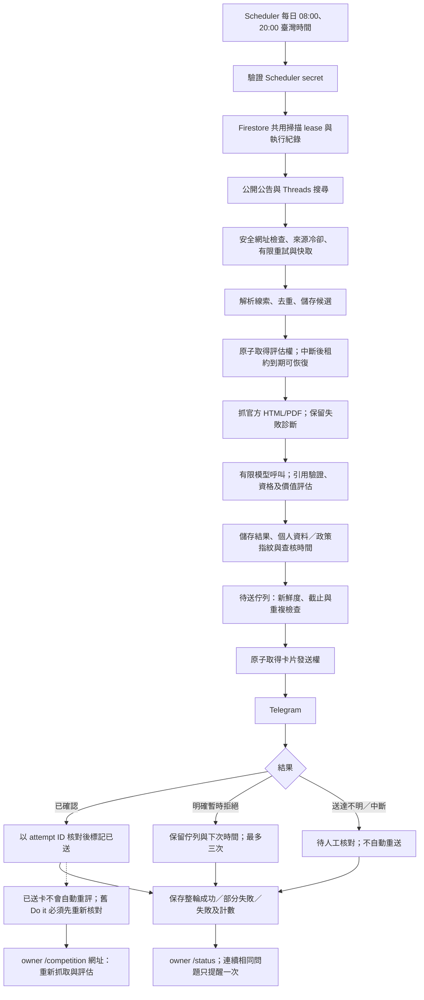

# Kairos 自動運作可靠性查核

查核開始：2026-10-24 23:13（Asia/Taipei）。依實際程式、Cloud Run／Scheduler 設定、執行紀錄與 Firestore 狀態查證；歷史報告只作索引。

## 實際流程

競賽流程不會報名、付費、接受條款或交件；自動流程不會批准 outreach、寄主辦詢問信、公開回覆或送 Threads 私訊。設定信箱不等於授權，Workflow 仍不啟用自動寄件。原有手動草稿／核准邊界保留，`send_uncertain` 不加入任何自動恢復路徑。

## 修正前的正式基準

- 正式流量位於 `kairos-git-d794fe3-r2`。Cloud Run timeout 600 秒、concurrency 80、max instances 20，沒有整輪共用鎖或完成紀錄。
- Scheduler `kairos-opportunity-scan` 已啟用：`0 8,20 * * *`、`Asia/Taipei`、attempt deadline 600 秒，未額外設定重試。
- 10/24 20:00 的正式請求回傳 HTTP 200，Cloud Run 記錄約 134 秒；Scheduler 有 started／finished 紀錄。**舊程式沒有保存回傳計數，無法證明該輪所有來源、評估與通知皆成功。**
- 初始狀態為待評估 77、skipped 9、Telegram 已送 5、draft_ready 1；沒有卡住的 telegram_sending、telegram_uncertain 或 send_uncertain。未設定主辦寄件憑證。
- Telegram 認證可用、webhook 指向正式服務、pending updates 0、沒有 webhook error date。這些是外部介面健康證據，不是發現流程成功證據。

## 本輪處理的問題

| 風險 | 實際缺陷與修正 | 恢復邊界 |
|---|---|---|
| 一筆故障中止整輪 | 候選與來源介面例外分開計數，繼續獨立工作 | 資料庫整體不可用仍可能使整輪失敗，不假裝正常無結果 |
| HTTP 200 被當完整成功 | 新增 `kairos_scan_runs`，區分 succeeded、partial、failed、running、abandoned | 舊紀錄不回填虛構成功；成功指在單輪上限內完成 |
| 並行／中斷 | 共用 600 秒 lease、480 秒協作式執行期限；過期執行可由下一輪取代 | SDK／基礎設施阻塞並非硬即時保證；失效狀態需看紀錄 |
| 配額失敗放大請求 | Threads 401／403／429 停止本輪後續關鍵字；模型 429 停止後續競賽分析 | 下輪再試；持續認證／配額問題須修憑證或配額 |
| 模型例外繞過計量 | 在實際呼叫供應商前保留模型名額，不只計算成功結果 | 正式設定每輪三場；既有 fallback 最多兩個模型，不代表用量免費 |
| 明確通知拒收失去重試 | 429 或連線尚未建立可延後重試；一般永久拒收標 telegram_failed | 最多三次；格式／權限／封鎖／憑證錯誤須人工修正 |
| 通知結果不明 | timeout／不可判定回應仍標 telegram_uncertain；卡住發送過十分鐘也轉待核對 | 不自動重送；不能因沒存到 message ID 就宣稱未送出 |
| 舊 worker 覆蓋新決定 | 發送完成用狀態與 attempt ID 作條件更新，只動通知欄位 | 較新的略過等動作不會被發送結果覆蓋 |
| 重試阻塞健康卡片 | 未到重試時間的項目在排序前排除 | 其他項目可照常送出，不佔卡片名額 |
| 過期／背景改變 | 24 小時與 profile／policy 指紋檢查；待送舊評估回到重評 | 不變更真實截止；舊 Do it 被阻擋，須重新核對 |
| 相同來源仍沿用舊資格 | 引文補用也必須符合當前 profile／policy 指紋 | 內容相同不代表使用者仍符合資格 |
| 無法辨識維運狀態 | owner `/status`、受保護 `GET /tasks/status`、整輪計數及有限告警 | 不把未知欄位補成合格，也不以測試總數取代正式流程證據 |

## 驗證分層

1. **程式及受控故障**：測試單筆例外、來源解析失敗、執行逾時、重疊執行、中斷接手、限流停止、模型呼叫預算、明確拒收與送達不明、重試上限、舊 worker、評估時間及 profile 改變。修正後的確切部署來源通過 244 項測試，數量不是可靠率。
2. **真實 Firestore、隔離資料**：在 `kairos_scan_validation`、`kairos_delivery_validation`、`kairos_fetch_validation` 驗證共用 lease、兩個同時 claim 只成功一個、舊完成不能覆寫新動作。429 由 MockTransport 注入，但冷卻存在真實 Firestore，第二個 fetcher 零新增 HTTP 呼叫；沒有對真實來源製造 429，也沒有寫正式候選或送 Telegram。
3. **真實外部唯讀**：讀正式設定／歷史執行紀錄，呼叫 Telegram getMe/getWebhookInfo。沒有改 webhook 或傳訊給第三方。
4. **正式流程**：下方發布紀錄另列，與上述模擬分開；手動呼叫正式路徑仍不能代替下一次 Scheduler 自動執行的證據。

本機證據：`work/reliability/baseline.json`、`state-baseline.json`、`recent-logs.json`、`live-state-verification.json`、`external-readiness.json` 與 `release-manifest.json`。完整私人紀錄與憑證不提交 Git。

## 如何看狀態及恢復

- 在 owner Telegram 傳 `/status`：看最後完成、最後完整成功、連續未完整成功、送達不明、通知待修復及已送評估需重查。最多讀取 500 筆狀態樣本；大於此範圍不可當完整盤點。
- 来源冷卻、短暫網路或模型失敗：保留候選，等待冷卻／重試時間及下一輪排程。沒有即時無限重試。評估中斷的候選過十分鐘可重新取得評估權。
- `telegram_uncertain`／`send_uncertain`：先由 owner 查看聊天室／對方收件狀態，再決定如何對帳；不得直接重設為待送。永久拒收或三次失敗須修正原因；競賽可在修正後由 owner 明確重新送出 `/competition 網址`，這是新操作，不是背景重試。
- `/status` 顯示未完整成功或資料庫無法讀取：先檢查當輪 run、來源診斷與 Cloud Run／Scheduler 記錄。恢復憑證或服務後，下輪接手；資料庫不可用期間無法保證寫入失敗紀錄，不能把沒有紀錄解讀成正常。
- 已送卡不會因 profile 指紋改變而自動改寫。舊卡仍是歷史訊息；新的執行指令會先檢查新鮮度，必要時由 `/competition` 重查。個人資料本身仍需人工確認更新，指紋不是事實查證。

## 用量與尚未解決的限制

- 現行 28 組去重關鍵字；一般搜尋每詞最多兩次，明確認證／429 會提前停止。公開公告 21 個入口、每入口最多兩頁、四個並行工作者，並保留既有時間與大小限制。
- 每輪最多三次競賽模型評估、最多九次規則抓取嘗試，每次最多六份文件。每輪通知上限三張，pending 卡上限一張。480 秒為 async 協作式期限，Cloud Run／Scheduler 為 600 秒；不能視為基礎設施故障時的硬即時上限。沒有量測或宣稱 API 金額、token 費用或省下的訂閱 quota。
- 已送推薦不會在背景完整重評或自動更正所有卡片；主辦事後改條款可能在再次抓取前未被發現。已略過紀錄也不會自動恢復，避免覆蓋 owner 決定，可能漏掉延長期限或變更後的機會。
- 既有等價網址查重只看有限歷史窗口；不同網址轉載、跨活動名稱、歷史窗口外的變體仍有重複風險，不能宣稱全球 exactly-once。
- 全部 webhook 操作尚未具備 update_id 級別的耐久去重；卡片 attempt ID 與狀態條件保護正常發送，但獨立的手動重評與 webhook 重送仍需進一步驗證。
- 共用 lease 防止並行掃描，尚未依同一期排程事件永久去重；成功結束後的順序重投仍可能開新一輪。[Scheduler 官方文件](https://docs.cloud.google.com/scheduler/docs/reference/rest/v1beta1/projects.locations.jobs)提供跨重試不變的 ScheduleTime，可作後續事件去重依據，但本輪未冒稱已實作。
- 排程若完全停用或根本未觸發，工作本身無法發出失敗提醒；目前需要查看 `/status` 的時間及 Scheduler 記錄，尚無獨立的 missed-run 監控。手動執行紀錄不能證明排程仍在觸發。
- 來源結構改變、JavaScript 或 403 能暴露問題，不能自行修好解析器／權限。低模型上限與大量未評估候選會造成排隊延遲，沒有宣稱所有線索在截止前都已審查。
- 外部系統無共同交易；Telegram 接受後程序中止仍可能只留下送達不明。這是人工核對情況，不用盲目重送偽裝成 exactly-once。

## 正式發布紀錄

- 在 `kairos-git-baac801` 手動呼叫正式 `/tasks/discover`，145.36 秒回傳 HTTP 200；真實搜尋無錯誤，模型名額使用三次、候選例外零、通知錯誤零。Firestore 中同一 run ID 的完成紀錄為 **partial**，沒有宣稱完整成功，`last_full_success` 仍無紀錄。這次不是 Scheduler 觸發。
- 實際問題：公告端 `www.moc.gov.tw` 與 `hac.kmu.edu.tw` 回傳 403；另有一筆規則頁沒有可引用事實，該筆沒有模型例外，保留 pending 與重試時間。這些都沒有被當作正常零結果或合格機會。
- 此輪實際送出一張卡，但查核確認是已推薦活動的轉知重複，**不能當作新增有效推薦**。已用文件版本條件停止該重複紀錄，原地更正相同 Telegram 訊息並移除執行按鈕，沒有再發一張卡，保留 owner 回答。已人工確認的 primary／companion 對應現在共用推薦 identity；沒有任意合併相似名稱。
- 使用該正式案例保存的真實資料，透過最終部署來源受控重播：原主辦卡已送的情況下，轉知卡被抑制、捕捉通知零、額外模型呼叫零、正式候選寫入零。另補上資訊不足／模型例外分項計數，並延長資訊不足頁面的重評等待。
- owner `/status` 已通過實際 webhook 路徑，Telegram 接受狀態訊息；沒有因此評估、修改候選、聯絡主辦或證明 owner 已讀。已移除兩個過時測試 revision tag，防止從舊測試網址繞過新掃描保護；歷史 revision 保留作回滾。
- 最終程式版本 `c1cecb8` 的來源測試及重播完成；發布使用 `kairos-git-c1cecb8`。最後兩項修正沒有再觸發一輪真實掃描，以免額外消耗模型額度或發送推薦。需等待 **2026-10-25 08:00 Asia/Taipei** 的下一次正式排程驗證；目前不能宣稱新版本已完成自動排程，更不能宣稱長期穩定。
- 最終讀回確認 `kairos-git-c1cecb8` 接收 100% 流量、版本標記正確、健康正常、未授權 `/tasks/status` 回傳 403、舊 tag 已移除、Threads DM 停用。結果保存在 `work/reliability/final-production.json`；這些檢查沒有再觸發掃描。
- 後續修改資格／AI／工時政策時，要更新 `evaluation_context` 的 policy 標記；單純記住舊 profile 不代表背景事實仍新鮮。硬中斷的追查也應包含 abandoned 歷史，不能只看已完成輪次的連續失敗計數。
